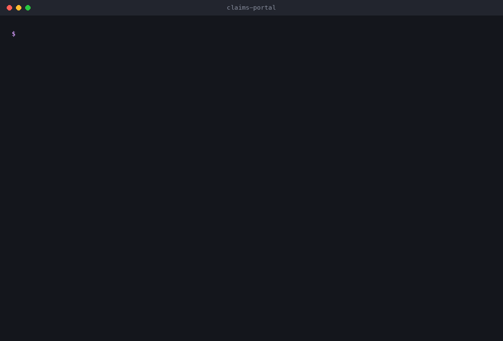
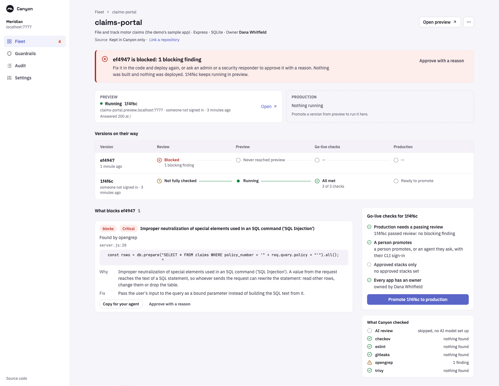
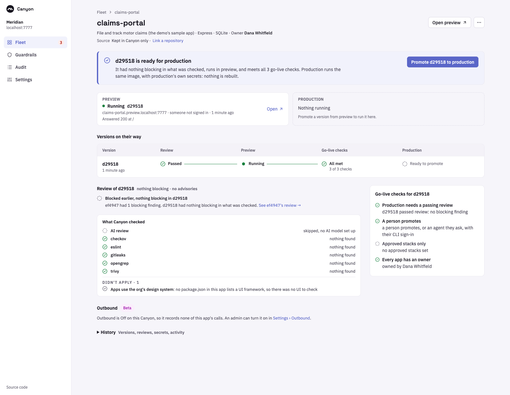
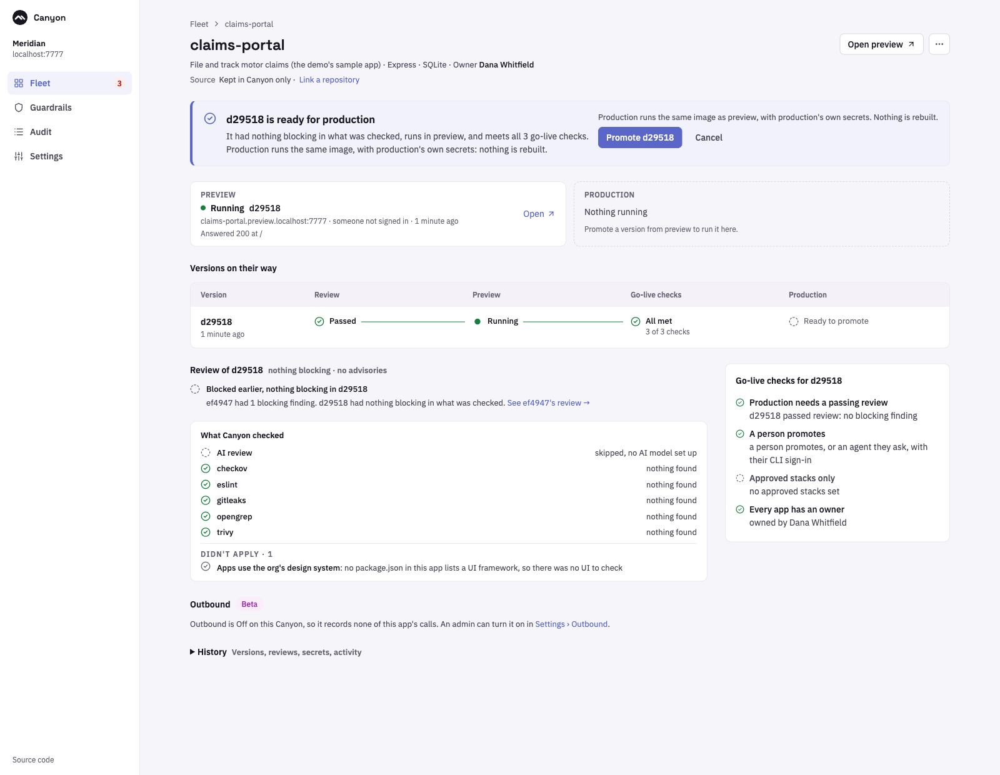
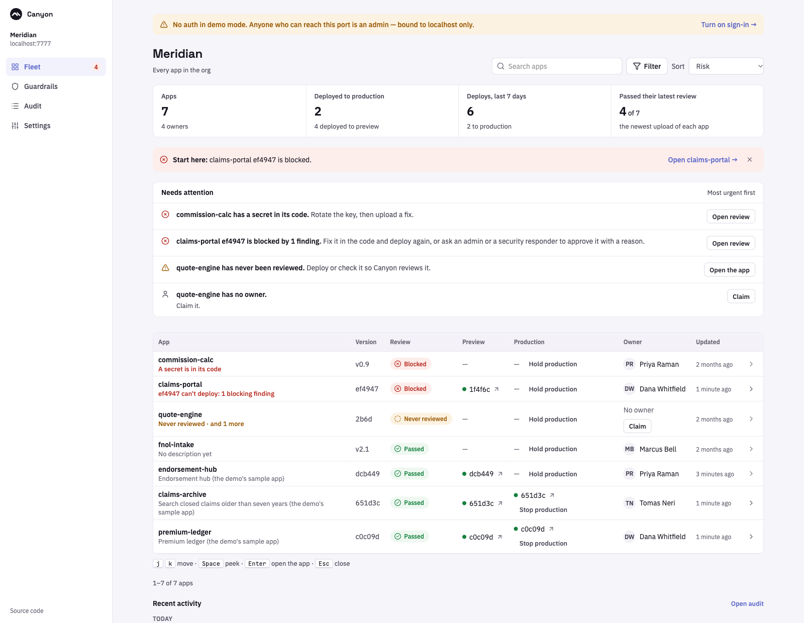

<p align="center">
  <a href="https://www.getcanyon.ai/">
    <picture>
      <source media="(prefers-color-scheme: dark)" srcset=".github/assets/canyon-mark-dark.svg">
      
    </picture>
  </a>
</p>

<h1 align="center">Canyon</h1>

<p align="center"><b>Your coding agents ship apps. Canyon reviews every deploy.</b></p>

<p align="center">
  A review gate and app platform for software built with AI. Open-source scanners, and an
  AI review when you give it a model, check every deploy against your org's rules, your agent gets findings it can fix, and a
  person promotes to production. Runs on your laptop or your Kubernetes.
</p>

<p align="center">
  <a href="https://www.getcanyon.ai/docs/start/what-is-canyon/">Docs</a> ·
  <a href="#quickstart">Quickstart</a> ·
  <a href="https://www.getcanyon.ai/docs/self-host/kubernetes/">Self-host</a> ·
  <a href="https://github.com/getcanyon-ai/canyon/discussions">Discussions</a> ·
  <a href="CONTRIBUTING.md">Contributing</a>
</p>

<p>
  
</p>

An agent's deploy is blocked, it fixes the line, and the next check passes.

<p>
  <picture>
    <source media="(prefers-color-scheme: dark)" srcset=".github/assets/01-blocked-dark.png">
    
  </picture>
  <picture>
    <source media="(prefers-color-scheme: dark)" srcset=".github/assets/02-passed-dark.png">
    
  </picture>
</p>

Blocked: the agent built SQL from the request. · Passed: after the agent's one-line fix.

**Try it in minutes:** paste the [tour prompt](https://www.getcanyon.ai/docs/start/take-the-tour/) into Claude Code, Codex or Cursor.

`canyon check` on the demo's claims-portal, whose next version builds its SQL from the request:

```text
  ✗ Review blocked · 1 blocking finding
    · AI review          off (no AI model set up on this Canyon)
    ✓ checkov            clean
    ✓ eslint             clean
    ✓ gitleaks           clean
    ✗ opengrep           1 blocking finding
    ✓ trivy              clean

  ────────────────────────────────────────────────────────────────────────────

  critical  Improper neutralization of special elements used in an SQL command ('SQL Injection')
  server.js:20:27

    20 │   const rows = db.prepare("SELECT * FROM claims WHERE policy_number = '" + req.query.policy + "'").all();
       │                           ^^^^^^^^^^^^^^^^^^^^^^^^^^^^^^^^^^^^^^^^^^^^^^^^^^^^^^^^^^^^^^^^^^^^^^^

  Improper neutralization of special elements used in an SQL command ('SQL
  Injection'). A value from the request reaches the text of a SQL statement,
  so whoever sends the request can rewrite the statement: read other rows,
  change them or drop the table.

  fix   Pass the user's input to the query as a bound parameter instead of
        building the SQL text from it.
  why   Policy "No hand-built SQL from user input"
```

Nothing was built, and the version before it keeps running. Pass the policy number as a bound
parameter on line 20 and `canyon check` passes.

## Why Canyon

Your teams started shipping apps with coding agents, and most of those apps are useful. Some also
hold a live key in the browser bundle, an `/admin` route anyone can open, or SQL built from a query
string. You can't ban the apps, and you can't review them all by hand.

Canyon reviews every deploy before it runs. It checks the code with open-source scanners and, when
you give it a model, an AI review, against your org's rules. Findings come back as a file, a line and
a fix, which the agent handles like a compiler error. By default nothing reaches production without
a passing review and a person's say-so, and every app keeps its review history and an audit trail.

<p>
  <picture>
    <source media="(prefers-color-scheme: dark)" srcset=".github/assets/03-promote-dark.png">
    
  </picture>
  <picture>
    <source media="(prefers-color-scheme: dark)" srcset=".github/assets/04-fleet-dark.png">
    
  </picture>
</p>

## Quickstart

**Run Canyon on your laptop** (Docker 28 or newer with Compose v2, 4 CPUs and 6 GB of memory for it, about 18 GB of free disk, 30 GB with Docker's containerd image store):

```sh
curl -fsSL https://github.com/getcanyon-ai/canyon-releases/releases/latest/download/install.sh -o install.sh && sh install.sh
canyon demo up
```

The first line installs the CLI. `canyon demo up` checks your machine, starts the demo and signs the
CLI in to it. Open `http://localhost:7777`. You're in Meridian, a fictional company with seven apps;
the demo builds four of them through Canyon, and claims-portal's next version is blocked for a SQL
injection. [Try it on your laptop](docs/src/content/docs/start/try-it-on-your-laptop.md) walks
through it with the real output. `canyon demo down` removes it, and `canyon demo down --purge` its
images too.

That installs the latest release, from
[canyon-releases](https://github.com/getcanyon-ai/canyon-releases), Canyon's download repository.

**Let your agent ship.** `canyon skill install` teaches Claude Code, Codex and Cursor, and with
`--harness agents-md` any agent that reads an `AGENTS.md`, how to deploy with Canyon and fix what the
review finds, and gives them Canyon's tools over MCP. Then ask it to "deploy this
app". Or run `canyon deploy` in the app's directory yourself.
[Use it from your coding agent](docs/src/content/docs/start/use-it-from-your-coding-agent.md) shows
what that writes on your machine and a real agent's deploy. A coding agent in the cloud, such as
Claude Code on the web, connects to your team's Canyon at `https://<canyon>/mcp` instead
([Connect your agent](docs/src/content/docs/start/connect-your-agent.md)).

## What it checks

gitleaks for secrets, Trivy for known-vulnerable dependencies, Opengrep and ESLint for code patterns
such as SQL built from user input, and Checkov for infrastructure config; an admin can turn on Grype
too. With a model, an AI review looks for what scanners can't, such as a route with no sign-in; it
only adds findings. Without one, the review says the AI review was skipped.

Every finding names a rule. Canyon ships 21, and an admin can add their own and set each to Off,
Advisory or Blocking. Out of the box these block:

| Rule | Blocks |
|---|---|
| No secrets in the code (`secrets.client-bundle`) | a key, token or password in the source |
| No hand-built SQL from user input (`sql.string-concat`) | a request value pasted into SQL text |
| Production needs a passing review (`prod.clean-gate`) | promoting a version whose review didn't pass |
| A person promotes (`prod.human-approval`) | a promotion to production that no person made |

## Run it for your org

- **[Install on Kubernetes](docs/src/content/docs/self-host/kubernetes.md):** what Canyon ships and what you bring. EKS with
  ECR, and [a single k3s host](docs/src/content/docs/self-host/k3s.md), are tested. To try it on a cluster first, use the
  [demo Helm chart](docs/src/content/docs/self-host/helm.md).
- **[Sign-in, the AI model and keys](docs/src/content/docs/org/set-up.md):** your OIDC provider,
  the model the review uses, and rotating the encryption key.
- **[Check pull requests](docs/src/content/docs/build/github.md):** the GitHub App reviews every push and pull request with
  the same review, as a required check.

One Canyon serves one org. It signs everyone in through your own identity provider and is not
multi-tenant. Canyon governs what is deployed through Canyon; closing your org's other deploy paths
is still your job.

## Community

- **[Discussions](https://github.com/getcanyon-ai/canyon/discussions):** questions, ideas, show-and-tell.
- **[Issues](https://github.com/getcanyon-ai/canyon/issues):** bugs and feature requests, and above all a
  finding the review got wrong.
- **[Contributing](CONTRIBUTING.md):** how to build, test and send a change.
- **[Security](SECURITY.md):** report a vulnerability privately; we reply within two business days.

## Licence

Canyon is open source under the [GNU Affero General Public License v3.0](LICENSE) (AGPL-3.0-only),
with these parts under their own licences, as [LICENSE](LICENSE) says:

- `cli/` (with the agent skill in `cli/skill/`), `contracts/` and the few packages the CLI is
  built from (LICENSE names them): [Apache-2.0](cli/LICENSE). The `canyon` CLI is Apache-2.0
  throughout, so agents and tools can embed it.
- `deploy/gitops/`: [0BSD](deploy/gitops/LICENSE), so you can copy it into your own deploy repo.
- Every `ee/` directory: the [Elastic License 2.0](ee/LICENSE). You may use, change and share
  it, but not offer it to others as a hosted or managed service, or work around its licence key.
  Its features need a Canyon Enterprise licence.
- The third-party files listed in [NOTICE](NOTICE) and the IBM Plex, Space Grotesk and JetBrains
  Mono fonts in `web/src/fonts/` (SIL Open Font License) keep their own licences.

Contributors sign the [contributor licence agreement](CLA.md) once, on their first pull request
([CONTRIBUTING.md](CONTRIBUTING.md)).
