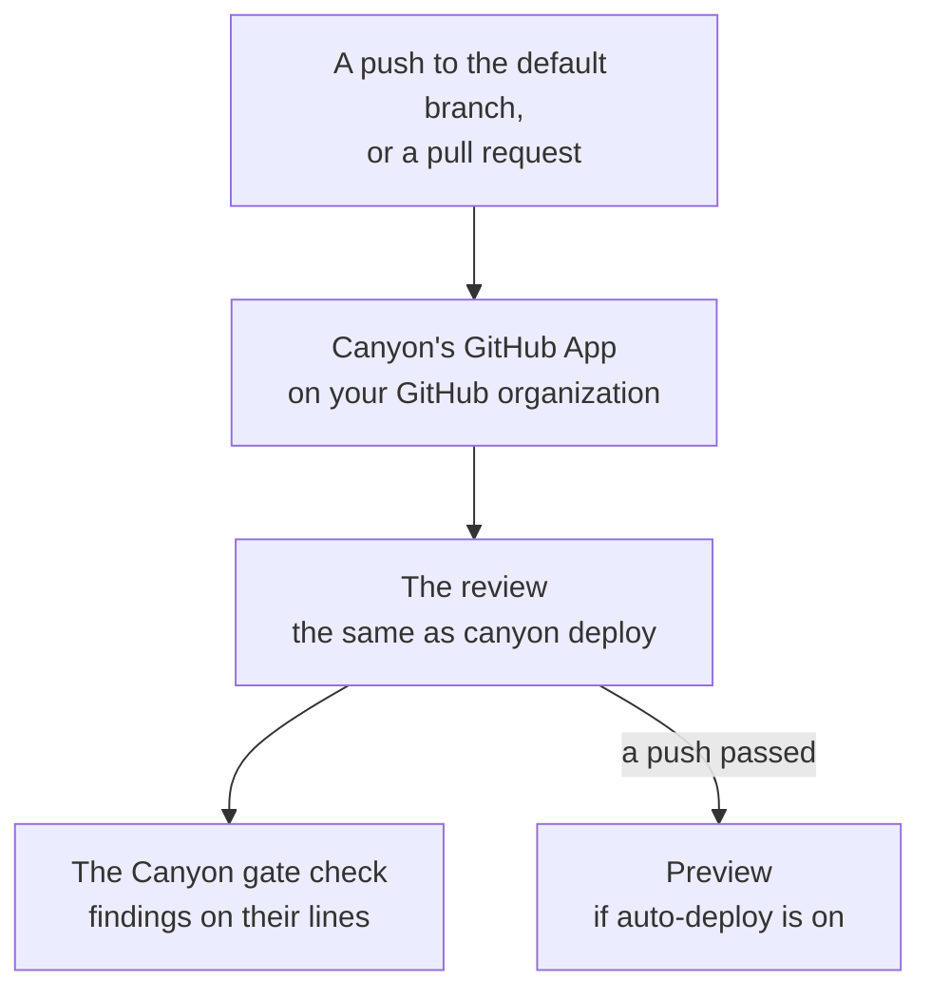

Once an admin connects GitHub, a push to the default branch or a pull request becomes a new
**version** of the app, and goes through the same review as `canyon deploy`. The result shows on
GitHub as a check named **Canyon gate**, with each finding on the lines it is about. *Canyon gate* is
the review's name on GitHub; these pages call it the review.



## Before you start: your admin connects GitHub

Canyon reads your repositories through a GitHub App: a private app on GitHub that Canyon registers
for itself, one on each GitHub organization it reads. An admin does this once, in the dashboard's
**Settings › GitHub**:

1. They type the organization's name, and say whether it holds only Canyon apps.
2. They press **Register Canyon on &lt;org&gt;**, then confirm on GitHub. This needs someone who is an
   owner of the organization on GitHub, or a GitHub App manager there.
3. GitHub creates the App, named `Canyon — <org>`, and Canyon sends them to its installation page.
   There they pick the repositories Canyon may read.

The App can read contents, metadata and code-scanning results, and write checks. Ticking **Keep code
for apps that start in Canyon here** also lets it create repositories and commit to them.

GitHub can't send events to `localhost`, so this needs a Canyon with a public address. The
[laptop demo](/start/try-it-on-your-laptop/) can't connect to GitHub.

## Which app a repository feeds

A repository feeds only the apps linked to it. An admin links them in **Settings › GitHub**, and an
app's contributors from its page, under **Source**, typing the repository as `owner/name`: their own
GitHub account, linked in Canyon, must be able to read it. Its name doesn't matter: a repository named
like an app changes nothing of that app.

A link is a whole repository or one folder in it, so one repository can feed several apps, one per
folder. Each app gets its own check: **Canyon gate** for a whole repository, and
**Canyon gate · &lt;folder&gt;** for a folder. A push makes a new version of each app whose folder
changed since that app's last push that passed review.

A repository no app is linked to gets one neutral check, "This repository isn't linked to a Canyon
app". If GitHub renames, moves, archives or deletes the repository, the link follows it, and the app
keeps every version.

## What a push does

Only pushes to the default branch count. Other branches and tags are ignored.

1. Canyon takes the commit's files exactly as it takes an upload from the CLI, and checks the
   `[resources]` section of its `canyon.toml` (see [Databases for your app](/build/databases/)). If
   it refuses the code, the check fails and says why.
2. The commit becomes the app's current version.
3. The review runs. GitHub has no way to approve a finding: approve it on the app's page in Canyon
   (see [When a review blocks you](/build/fix-or-approve/)).
4. The check passes when the review finds nothing blocking, or when every blocking finding is
   [approved](/build/fix-or-approve/#approve-it-instead). Otherwise it fails. Each finding is an annotation on its lines,
   up to 200; the check's summary counts the rest.

A push deploys to preview only when the app's owners turned on **Auto-deploy pushes to preview** on
the app's page, and only once the review passes. A push never promotes to production (see
[Get to production](/build/production/)).

The check fails, and says why, when another deploy or review of the app is still going after 10
minutes, when the review takes longer than 35 minutes, or when Canyon can't finish it. Push again.
When Canyon's limit of reviews an hour is reached, the check says when to push again.

## Link your GitHub account

Link the GitHub account you push with, so Canyon knows your pushes are yours. This matters for
[approvals](/org/who-can-do-what/#approving-a-blocking-finding): a push's deploy belongs to whoever
linked the account that pushed, so nobody approves their own push.

1. At the foot of the dashboard's side menu, choose **Link GitHub account**.
2. Sign in to GitHub. GitHub tells Canyon which account you signed in with, so you can only link an
   account that is yours. A renamed account stays linked.

An admin can make linking required for anyone who approves a push's blocking findings:
**Guardrails → Policies → Approvers of a push must link GitHub**.

**Link GitHub account** shows only once Canyon holds the GitHub App's client secret. An App
registered from Canyon v0.2.0 or later has it. For an App registered earlier, an admin adds it once:

1. On GitHub, open the App's settings: **Settings › Developer settings › GitHub Apps**, or the App's
   link in Canyon's **Settings › GitHub**.
2. Add `<your Canyon address>/api/v1/github/link/callback` as a **Callback URL**.
3. Under **Client secrets**, choose **Generate a new client secret**.
4. Paste the secret into the App's row in Canyon's **Settings › GitHub**.

## What a pull request does

A pull request from a branch of the same repository is reviewed like a push each time it is opened
or pushed to. Its check shows on the pull request. Pull requests from forks are ignored.

A pull request's version never becomes the app's current version, and never goes to production. It
is listed on the app's **Reviews** tab in the dashboard. Once its newest review passes, or every
blocking finding is approved, a person can press **Deploy this pull request to preview** there. When
the pull request is merged, the push of the same code makes it the current version.

## Make the check required

To stop a pull request merging until Canyon passes it: in the repository's settings on GitHub, add a
branch ruleset (or a branch protection rule) for the default branch. Turn on **Require status checks
to pass**, and add **Canyon gate**. The name must match exactly. For an app in a folder, add that
folder's **Canyon gate · &lt;folder&gt;** check.

## For operators: test the webhook by hand

GitHub tells Canyon about each push by calling Canyon's webhook, signed with the App's webhook
secret. To check that a Canyon receives and accepts these calls, send one yourself, with the App's
webhook secret in `$SECRET` and a delivery body (a push event's JSON, copied from the App's
**Advanced → Recent Deliveries** on GitHub) in `push.json`:

```sh
sig=$(openssl dgst -sha256 -hmac "$SECRET" < push.json | sed 's/^.* //')
curl -i "$CANYON_URL/webhooks/github" -H "X-GitHub-Event: push" -H "X-GitHub-Hook-Installation-Target-ID: $APP_ID" \
  -H "X-GitHub-Delivery: $(uuidgen)" -H "X-Hub-Signature-256: sha256=$sig" --data-binary @push.json
```

`$APP_ID` is the App's id, from its settings page on GitHub. `202 {}` is accepted, `204` is a correctly
signed event Canyon doesn't act on (another branch, a fork's pull request, an installation it doesn't
know), `401 bad_signature` is the wrong secret or an App this Canyon doesn't have,
`413 too_large` is a body over 5 MiB, and `503 not_configured` is no App yet.
