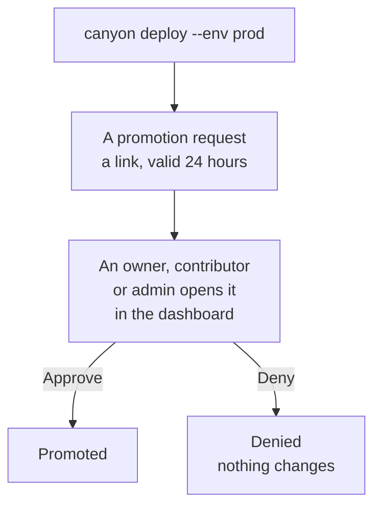

`canyon deploy --env prod` promotes the exact image preview runs, with production's own secrets. It
needs a passing review and a person's say-so, and where your org asks for it, a person's approval in
the dashboard.

Every app has two environments: **preview**, where each `canyon deploy` lands, and **production**.
To **promote** is to run the version preview runs in production. `canyon deploy --env prod`
promotes: nothing is uploaded and nothing is rebuilt. Production runs the same image preview built,
with its own secrets. So the way to production is always through preview: `canyon deploy` first,
then `canyon deploy --env prod`.

## Before you promote

- **The version must be running in preview.** If your code changed since then, the CLI stops and
  tells you to deploy it to preview first.
- **Set production's secrets.** Production doesn't read preview's values. Set each one with
  `--env prod` before you promote ([Secrets](/build/secrets/)).
- **The go-live checks pass.** These are the rules your org placed before production. `canyon status`
  lists them, and the app's page in the dashboard shows them as **Go-live checks**:

```sh
canyon status
```

```text
  amber-gecko-w4g · Meridian

  preview      e87c28   http://amber-gecko-w4g.preview.localhost:7777   just now
  production   —        not promoted yet
  access       anyone who can reach this Canyon (sign-in is off)
  review       ✓ passed   0 blocking findings, 0 warnings   just now

  ✓ Production needs a passing review
      e87c28 passed review: no blocking finding
  ✓ A person promotes
      a person promotes, or an agent they ask, with their CLI sign-in
  · Approved stacks only
      no approved stacks set
  ! Every app has an owner             advisory
      no owner has claimed this app

  Open in Canyon http://localhost:7777/#/apps/amber-gecko-w4g
```

Out of the box, two checks are Blocking: they stop the promotion until they pass.
[Production needs a passing review](/rules/prod.clean-gate/) and
[A person promotes](/rules/prod.human-approval/). Two are Advisory: they show on the list and stop
nothing. [Approved stacks only](/rules/stack.blessed/) and
[Every app has an owner](/rules/owner.required/). Your org decides which block, and can place other
rules before production too; those show up in the same list
([Set guardrails](/org/guardrails/#pipeline)).

## Promote

```sh
canyon deploy --env prod
```

On a terminal, it says what it will promote and asks before it changes production. Where nobody can
answer a prompt, as in a coding agent or CI, it refuses until you add `--yes`:

```text
  canyon · amber-gecko-w4g preview → prod · localhost:7777

  Promoting e87c28 (passed review) from preview to production. Nothing runs in production yet.
  Production runs the same image as preview, with production's own secrets. Nothing is rebuilt.
  ! GREETING is set for preview but not production. Set it with: canyon secret set GREETING --env prod

  ✗ deploy --env prod asks before it changes production, and nothing here can answer: re-run it with --yes
```

The `!` line warns that production is missing a secret preview has. The promotion would still go
ahead, and the app would run without that value.

```sh
canyon deploy --env prod --yes
```

```text
  canyon · amber-gecko-w4g preview → prod · localhost:7777

  Promoting e87c28 (passed review) from preview to production. Nothing runs in production yet.
  Production runs the same image as preview, with production's own secrets. Nothing is rebuilt.

  Promote
  │ deploying to production
  │ live at http://amber-gecko-w4g.prod.localhost:7777

  ✓ Promote    prod

  Live   http://amber-gecko-w4g.prod.localhost:7777 · answered 200 OK at /
         Team notes are coming soon.
  Fleet  http://localhost:7777/#/apps/amber-gecko-w4g
  Access anyone who can reach this Canyon (sign-in is off)

  Done in 12.1s
```

- **Your coding agent** runs this when you ask for production, and adds `--yes` only when you asked
  for production in that conversation. First it runs `canyon secret list`, and for each value
  production is missing it asks you to set it yourself in your own terminal, with
  `canyon secret set NAME --env prod`. It never asks for the value in the chat.
- **From the dashboard:** the app's page has **Promote _version_ to production**. It lists the
  secrets production lacks before you confirm.
- **Preview answering with an error:** when the version in preview answers its address with an
  error, the CLI won't promote it, with or without `--yes`. A person can still promote it from the
  app's page in the dashboard, with **Promote anyway**.
- **A pull request's version** can run in preview but is never promoted. Merge it, then deploy the
  default branch ([GitHub](/build/github/)).
- **Taking production offline:** `canyon undeploy --env prod` asks first (`--yes` in CI). The app's
  data is kept. It never waits on a run: a preview deploy goes on, and a promotion already switching
  production stops it the moment it lands.

## When your org has a person approve production

An admin can turn on **Production is approved in the dashboard**, in Settings › People & sign-in →
Production. It needs sign-in on. Then `canyon deploy --env prod` promotes nothing itself. It sends
a promotion request and prints a link to it, a code, and how long the request lasts.



- **A person decides, in the dashboard.** Someone on the app's team (an owner or a contributor) or an
  admin opens the link signed in, sees **Promote _app_ _version_ to production?** (or, for an earlier version, **Put _app_ _version_ back in
  production, replacing _version_?**), and clicks **Approve** or
  **Deny**. Your coding agent gives you the link and stops.
- **The request lasts 24 hours.** A new request replaces the one still waiting. If preview runs
  another version by the time someone approves, nothing is promoted: ask again.
- **`--wait` waits for the answer**, then follows the promotion to the end, or says who denied it.
  Ctrl-C stops waiting; the request stays open.
- **The app's page still promotes directly.** A person who clicks Promote there needs no second
  approval.

## Exit codes

`canyon deploy --env prod` exits 2 when it promoted nothing because:

- a go-live check blocks it;
- the version in preview answered its address with an error;
- your org has a person approve production, and the request is waiting, was denied or expired,
  was replaced by a newer request, or preview now runs another version;
- production is **held**: a security responder or an admin stopped it. The refusal says who, why,
  and whom to ask. Only a responder or an admin lets it run again, in the dashboard
  ([Who can do what](/org/who-can-do-what/#stopping-production)).

It exits 1 on any other error. All flags are on the [CLI reference](/reference/cli/).
