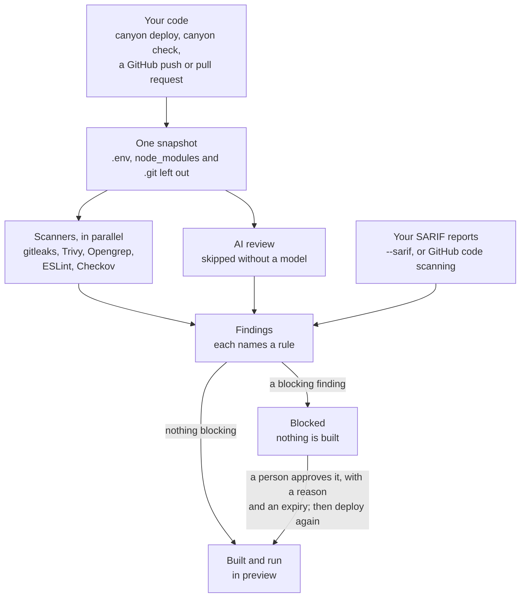
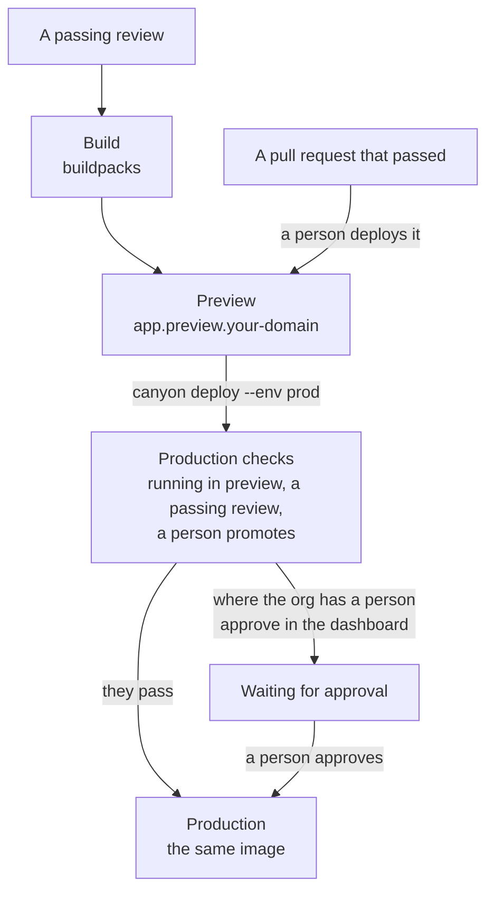

Canyon has two halves that never swap jobs. The **server** decides: it holds your org's rules,
the review, sign-in, secrets and the audit trail, and runs no app code. The **executor** does: it
scans, builds and runs apps, and keeps no org settings and no secrets. Apps can't reach the server,
its database or each other directly; from outside, they are like any other visitor.

The same parts run in two shapes: as containers on **one Docker host**, the laptop demo's, or as pods
on **your Kubernetes cluster**. [Choices at a glance](/concepts/modes/#where-canyon-runs) says which to
pick.

```diagram kind=layers title="Canyon's parts: the server decides, the executor scans, builds and runs, and every app sits behind sign-in"
layers:
  - band: Outside Canyon
    tiles:
      - {who: Agent, icon: agent, what: Coding agents, more: "on a laptop with the CLI, or in the cloud over MCP"}
      - {who: People, icon: people, what: Your team, more: in the dashboard}
      - {who: Sign-in, icon: key, what: Your identity provider}
      - {who: Optional, what: Your AI model, more: reads the code for the AI review}
  - via: deploys · the dashboard · sign-in · the AI review's call out
  - band: "`canyon-server` decides"
    note: and runs no app code
    tone: canyon
    tiles:
      - {tone: canyon, what: API and dashboard}
      - {tone: canyon, what: The review, more: "the scanners' findings, the AI review, your org's rules"}
      - {tone: canyon, what: Secrets vault, more: sealed under its own key}
      - {tone: canyon, what: Audit trail, more: "in Canyon's Postgres"}
  - via: "scan · build · run: one app per call, never a vault key"
  - band: The executor does
    note: and keeps no org settings and no secrets
    tone: canyon
    tiles:
      - {tone: canyon, what: Scans, more: "runs every scanner but gitleaks, which the server runs"}
      - {tone: canyon, what: Builds, more: an image with buildpacks}
      - {tone: canyon, what: Runs, more: "each app, in preview and production"}
  - via: starts each app
  - band: Your apps
    note: each behind your company's sign-in
    flow:
      - {who: People, icon: people, what: People using the apps}
      - {who: Canyon, icon: canyon, tone: canyon, what: Sign-in, more: "checks the person and the app's access list"}
      - {who: Yours, what: Your app, more: "told who is calling, in a token Canyon signs"}
      - {who: If it asks for one, what: Its own Postgres, more: "and, in beta, calls out through Canyon's egress gateway"}
    wall: "An app can't reach Canyon's API, its database or another app."
```

**Every app sits behind your company's sign-in.** On Kubernetes a Canyon sidecar,
`canyon-identity`, runs in front of each app; on one Docker host the server checks sign-in itself.
Either way, the app learns who is calling from a token Canyon signs. The laptop demo is the
exception: it runs with sign-in off, so anyone who reaches it opens every app, and apps get no
token.

## What runs where, on one Docker host

```diagram kind=layers title="Canyon on one Docker host: the server is also every app's front door"
layers:
  - band: Outside
    tiles:
      - {who: Agent, icon: agent, what: Coding agent and CLI, more: "uploads, deploys"}
      - {who: People, icon: people, what: People using Canyon, more: the dashboard}
      - {who: People, icon: people, what: People using the apps, more: "an app's address"}
  - via: all three reach one address, the server's
  - band: "`canyon-server`"
    note: "dashboard, API, review, secrets, audit, and every app's front door"
    tone: canyon
    tiles:
      - {tone: canyon, what: "Canyon's Postgres", more: on a network only the server joins}
      - {tone: canyon, what: "`canyon-executor`", more: "on :7778; holds the Docker socket; scans, builds and starts apps"}
  - via: the executor starts each app; the server forwards each request to it, with Canyon's identity token when sign-in is on
  - band: Each app, on a Docker network of its own
    flow:
      - {who: Yours, what: "An app's container"}
      - {who: Shared, what: "`app-postgres`", more: "the apps' databases, each app's made by the server"}
      - {who: Beta, tone: canyon, what: "`canyon-egress`", more: "Envoy and the egress check, while its calls go through Canyon; records each call to the server"}
    wall: "An app can't reach another app or Canyon's Postgres, and the server's API refuses connections from the app networks."
```

- **The server answers every app's address itself.** With sign-in on, it checks the person's Canyon
  session and the app's access list, then forwards the request with Canyon's identity token. In the
  laptop demo, with sign-in off, it forwards every request with no check and no token. There is no
  router and no sidecar.
- **Each app gets a Docker network of its own**, shared with the server, `app-postgres` and, while
  its calls go through Canyon, the egress gateway, so an app can't reach another app or Canyon's
  Postgres. The server's API refuses connections from the
  app networks; an app reaches only the key set that signs its identity tokens.
- **The executor holds the Docker socket** and has no route to Canyon's Postgres, which sits on a
  network only the server joins.
- **Builds use `pack`**, with the same Paketo buildpacks as on Kubernetes.

## What runs where, on Kubernetes

```diagram kind=layers title="Canyon on a Kubernetes cluster: who talks to whom"
layers:
  - band: Outside
    tiles:
      - {who: Agent, icon: agent, what: Coding agent and CLI, more: "uploads, deploys"}
      - {who: People, icon: people, what: People using Canyon, more: the dashboard}
      - {who: GitHub, what: GitHub, more: webhooks}
      - {who: People, icon: people, what: People using the apps, more: "through your gateway or ingress, which ends TLS"}
  - via: Canyon's address to the server; each app's address to canyon-router
  - band: "Canyon's own"
    tone: canyon
    tiles:
      - {tone: canyon, what: "`canyon-server`", more: "dashboard, API, review, secrets, audit; calls your identity provider, GitHub and the AI model if you set one"}
      - {tone: canyon, what: "Canyon's Postgres", more: reached by the server alone}
      - {tone: canyon, what: "`canyon-router`", more: "sends each app's address to its pod, on :4180"}
      - {tone: canyon, what: "`canyon-executor`", more: "on :7778, from the server only; works through the Kubernetes API"}
  - via: the executor creates them
  - band: What the executor runs
    tiles:
      - {what: Scan jobs, more: "no network, but Trivy's database"}
      - {what: kpack builds, more: "DNS and public HTTP(S), for dependencies"}
      - {what: App pods, more: "`canyon-identity` in front of each app"}
  - band: Each app
    flow:
      - {who: Canyon, icon: canyon, tone: canyon, what: "`canyon-identity`", more: "checks who is signing in"}
      - {who: Yours, what: "Your app, on :3000"}
      - {who: Shared, what: "Apps' Postgres, :5433", more: "each app's database, made by the server"}
      - {who: Beta, tone: canyon, what: "`canyon-egress`", more: "Envoy and the egress check, while its calls go through Canyon"}
    wall: "An app never reaches the server, Canyon's Postgres or another app."
```

| Part | Its job | What it may reach |
|---|---|---|
| `canyon` CLI | Packs the app's source and uploads it, prints the review, signs in with a device code. | Your Canyon's address. |
| `canyon-server` | The dashboard and the API. Signs people in through your identity provider. Runs the review: gitleaks and the AI review itself, the other scanners through the executor. Keeps approvals, the audit trail and app secrets, sealed under its own key. Receives GitHub's webhooks. | Its Postgres, the executor, the apps' Postgres to create each app's database and role, and public HTTPS: your identity provider, GitHub, the model, your org's rules repository, and your pipeline's webhook when handing off. The Kubernetes API on 443 or 6443, to read the cluster's service-account key set for the egress check's policy. Never an app. |
| Canyon's Postgres | Apps, runs, findings, approvals, the audit trail and sealed secrets. | Reached by the server alone. |
| `canyon-executor` | Runs each scan as a Job, each build through kpack, and each app as a Deployment with its own NetworkPolicy, all through the Kubernetes API. Writes an app's settings into a Secret it can create and delete, but never read. | The Kubernetes API, your registry, app pods on port 4183, and Canyon's egress gateway on 3128 for its check. Accepts connections from the server only. |
| Scan jobs | One per scanner, in `canyon-scans`, under a policy that lets nothing in or out. | Nothing, except that a Trivy scan asks Canyon's Trivy server, the one part here that downloads vulnerability databases from the internet. |
| kpack builds | Turn the reviewed source into an image with Paketo buildpacks, in `canyon-builds`. | DNS and public HTTP(S), to fetch dependencies. |
| `canyon-router` | Sends `<app>.preview.<domain>` and `<app>.prod.<domain>` (or `<app>-preview.<domain>` and `<app>-prod.<domain>`) to the right app. Your ingress and TLS certificate sit in front of it. | App pods on port 4180. |
| An app | Your code on port 3000, behind `canyon-identity`, a sidecar that checks who is signing in. When your own gateway doesn't sign people in, oauth2-proxy in the pod does, in front of the sidecar. | DNS, the apps' Postgres, and public addresses on 80 and 443. While outbound goes through Canyon, Canyon's egress gateway in their place, and the sign-in hosts in `CANYON_KUBE_SIGNIN_DIRECT`. Never the server, Canyon's Postgres or another app. |
| The apps' Postgres | One database and role per app that asks for one in `canyon.toml`. A separate server, on port 5433. | Nothing: the server and the apps reach it. |
| `canyon-egress` | Canyon's egress gateway, beta: Envoy with the egress check beside it. While an admin sends apps' calls through Canyon, it is an app's way out to the internet, records each call to the server, and under `allowlist` refuses what isn't allowed. DNS lookups and the sign-in hosts in `CANYON_KUBE_SIGNIN_DIRECT` still go out directly, unrecorded. | Public addresses on 80 and 443, and the server's receiver and policy. |

Who signs people in to an app on Kubernetes, your gateway or an oauth2-proxy beside each app, is the
front door an admin chooses: [How people reach apps](/self-host/front-door/) draws the request path
for each.

If your own platform already runs apps, Canyon can **hand off** instead: it still reviews and
builds, then sends a signed release to your pipeline rather than running the app.
[Choices at a glance](/concepts/modes/) lists this and every other choice, with its default.

## How a review decides



- **Every way in is the same review.** An upload from the CLI and a push or pull request through
  the GitHub App become the same kind of snapshot and go through the same checks.
- **It fails closed.** A scanner that can't run, times out or has no database blocks the review as
  unchecked. It never passes in silence. With no model set, the AI review says it was skipped.
- **Your rules decide what blocks.** Every finding names a rule, and the org sets each rule to Off,
  Advisory or Blocking. A Blocking rule stops a deploy for its high and critical findings; Advisory
  findings are shown and don't stop anything.
- **A blocking finding can be approved** with a reason and an expiry date, on the app's page
  ([who can, and how](/build/fix-or-approve/#approve-it-instead)). The next deploy then builds.

## How a version gets to production



- **Production runs the image preview ran**, with production's own secrets. Nothing is rebuilt.
- **The version must be running in preview**, and two rules stand in front of it, both blocking by
  default: its review passed, and a person promotes it, or an agent they ask, signed in as
  them.
- **An org can require a person's approval in the dashboard** for every promotion. Then
  `canyon deploy --env prod` ends `WAITING FOR APPROVAL` with a link, and a person on the app's
  team approves or denies it there.
- **A pull request's version can run in preview**, when a person deploys it from the app's
  page. It is never promoted: merge it, and deploy the default branch.
